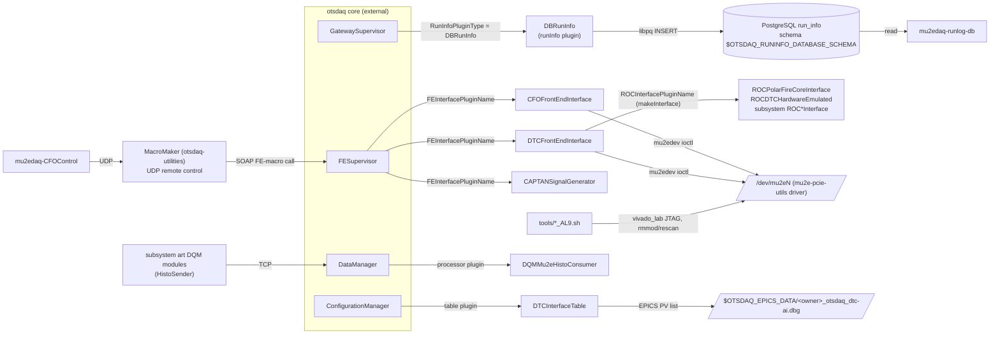

# otsdaq-mu2e

> Core otsdaq plugin package for Mu2e. It provides the CFO, DTC and ROC
> front-end interfaces and their FE macros, the DTC slow-controls table, the
> PostgreSQL run-info plugin and the DQM histogram transport, and ships the
> FPGA-programming and PCIe-reset scripts that are run on the DAQ nodes.

| | |
|---|---|
| Repository | `Mu2e/otsdaq-mu2e` (default branch `develop`) |
| Version | 11.03.00 (`CMakeLists.txt:13`) |
| Language | C++, built with cetmodules 3.19.02 (no `CXX_STANDARD` is set in the package); bash and Vivado Tcl in `tools/` |
| Ports | none bound by this package's own code (see [INTERFACES.md §9](INTERFACES.md#9-network-endpoints-other-packages-attribute-to-otsdaq-mu2e)) |
| Depends on | `otsdaq` 2.06.08, `otsdaq-components` 2.06.08, `artdaq-mu2e` 1.05.02 (and through it `artdaq-core-mu2e` and `mu2e-pcie-utils`), PostgreSQL 13.2 (`libpq`), nlohmann_json, ROOT (`CMakeLists.txt:70-73`, `RunInfoPlugins/CMakeLists.txt:3`) |
| Built on by | the subsystem packages `otsdaq-mu2e-{calorimeter,crv,dqm,extmon,stm,sync,tracker,trigger}` (`find_package(otsdaq-mu2e …)`) |

This review is Tier B: it covers structure and interfaces only. It is based on
the `CMakeLists.txt` files, the public headers, the plugin registration
macros, `tools/` and `doc/`. Implementation files were opened only to resolve
symbols named in a header. Paths below are relative to
`otsdaq-mu2e/otsdaq-mu2e/` unless they start with `tools/`, `doc/` or `test/`.

## Purpose

otsdaq-mu2e supplies the Mu2e-specific code that the generic otsdaq
supervisors load at run time:

- front-end (FE) interfaces for the CFO timing master and the DTCs;
- the ROC interfaces that each DTC creates for its links;
- the run-number and run-conditions writer that the GatewaySupervisor calls
  on every state transition;
- a slow-controls table plugin;
- a histogram consumer for the online DQM.

Every subsystem plugin package derives its ROC interfaces from this package's
`ROCCoreVInterface`.

## Architecture

## Components

| Component | Kind | Built as | Header |
|---|---|---|---|
| `CFOandDTCCoreVInterface` | abstract FE base: register access, 11 shared FE macros, EventBuildingMode phase constants | library `CFOandDTCCore` | `CFOandDTCCore/CFOandDTCCoreVInterface.h:19` |
| `CFOFrontEndInterface` | CFO FE: run plans, shared run plan, timing chain, loopback | library + FE plugin | `FEInterfaces/CFOFrontEndInterface.h:15` |
| `DTCFrontEndInterface` | DTC FE: ROC creation, event-building setup, CFO emulation, slow-controls channels | library + FE plugin | `FEInterfaces/DTCFrontEndInterface.h:17` |
| `ROCCoreVInterface` | abstract ROC base, the extension point for every subsystem ROC | library `ROCCore` | `ROCCore/ROCCoreVInterface.h:11` |
| `ROCPolarFireCoreInterface` | PolarFire ROC: register I/O, SPI-flash operations | library + FE plugin | `FEInterfaces/ROCPolarFireCoreInterface.h:10` |
| `ROCDTCHardwareEmulated` | ROC emulated inside the DTC firmware | FE plugin | `FEInterfaces/ROCDTCHardwareEmulated.h:10` |
| `CAPTANSignalGenerator` | CAPTAN pulse generator over UDP (`OtsUDPHardware`) | FE plugin | `FEInterfaces/CAPTANSignalGenerator.h:12` |
| `DTCInterfaceTable` | `SlowControlsTableBase` plugin for the DTC/ROC table tree | table plugin | `TablePlugins/DTCInterfaceTable.h:9` |
| `DBRunInfo` | `RunInfoVInterface` plugin writing to PostgreSQL | runInfo plugin | `RunInfoPlugins/DBRunInfo.h:45` |
| `DQMMu2eHistoConsumer` | `DQMHistosConsumerBase` processor that receives ROOT objects | dataProcessor plugin | `DataProcessorPlugins/DQMMu2eHistoConsumer.h:18` |
| `HistoSender`, `HistoReceiver` | ROOT-object TCP transport helpers. These are not art modules, despite the directory name | library `ArtModules` | `ArtModules/HistoSender.hh:11`, `ArtModules/HistoReceiver.hh:12` |
| `test/*` | five hand-run hardware drivers and `test_DCS.sh`; no automated tests | `cet_make_exec` | `test/CMakeLists.txt:3-38` |
| `tools/` | 52 files: firmware, PCIe reset, installation and snapshot scripts | installed as a directory; 4 scripts on `PATH` | [`otsdaq-mu2e-tools(7)`](../man/man7/otsdaq-mu2e-tools.7) |
| `UserWebGUI/` | web GUI assets for run control and DCS pages | static files | not reviewed |

## Interfaces

See [INTERFACES.md](INTERFACES.md), the primary deliverable. It lists every
registered plugin and how it is loaded, all FE macros as MacroMaker exposes
them, the run-info database edge, the environment, and the endpoints other
packages attribute to this one.

## Configuration

All plugin configuration comes from the otsdaq configuration tree
(`otsdaq-mu2e-config`) and from environment variables. The variables are
listed in [INTERFACES.md §7](INTERFACES.md#7-environment-variables-read).
The package ships no YAML.

## Operations

On DAQ nodes the firmware procedure runs `program_all_FPGA_AL9.sh` and
`reset_PCIe_AL9.sh` from `/home/mu2ehwdev`. Their man pages are in
`man/man1/`. Read them before you rely on `NOKILL` (OM-001, OM-003).

## Interactions with other packages

| Package | Edge | Evidence |
|---|---|---|
| `artdaq-mu2e`, `artdaq-core-mu2e`, `mu2e-pcie-utils` | link (`DTCInterface`, `CFOInterface`, `Overlays`) | `CMakeLists.txt:72`, `CFOandDTCCore/CMakeLists.txt:5`, `ROCCore/CMakeLists.txt:5-6` |
| `otsdaq-mu2e-*` subsystem packages | link to `otsdaq-mu2e::ROCCore`, `::ROCPolarFireCoreInterface`, `::ArtModules` | e.g. `otsdaq-mu2e-stm/otsdaq-mu2e-stm/FEInterfaces/CMakeLists.txt:4` |
| `otsdaq-mu2e-config` | selects these plugins by name in its tables; exports the `OTSDAQ_RUNINFO_*` variables | `otsdaq-mu2e-config/Data_trigger/db_setup_ots.sh:8-15` |
| `mu2edaq-runlog-db` | reads the tables `DBRunInfo` writes | `mu2edaq-runlog-db/docs/INTERFACES.md` §3.3 |
| `mu2edaq-CFOControl` | calls this package's CFO/DTC FE macros through the MacroMaker | `mu2edaq-CFOControl/ots_mm_udp_interface.py:409` |
| `mu2edaq-operations` | shares `/tmp/mu2e.lock` with the `_AL9` tools | `mu2edaq-operations/scripts/read_dtc_temps.sh:95` |
| `mu2edaq-documentation` | shifter procedure `experts/daq/flash-firmware.md` runs the firmware tools | that page, lines 39, 48, 63 |

## Review findings

Staged in [ISSUES-PENDING.md](ISSUES-PENDING.md): OM-001 to OM-013.
