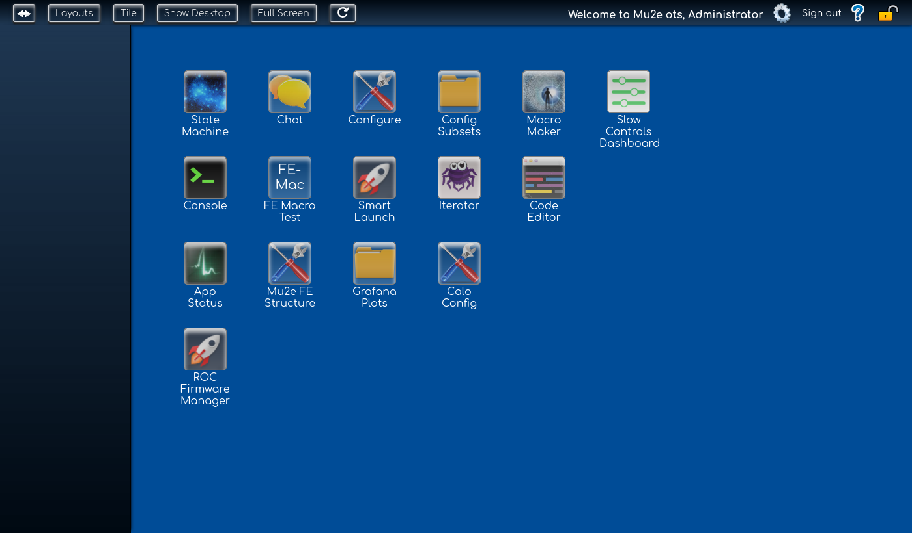
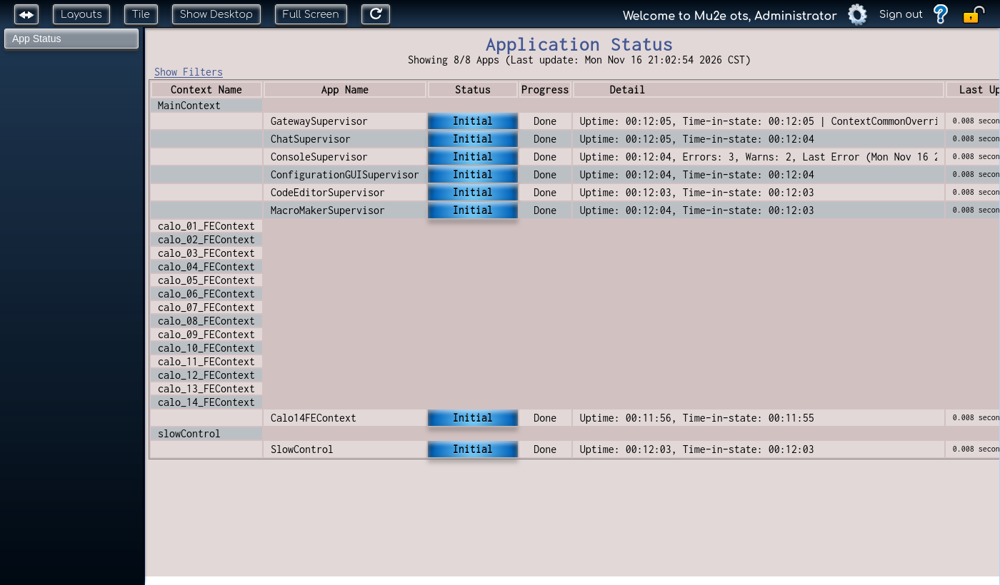
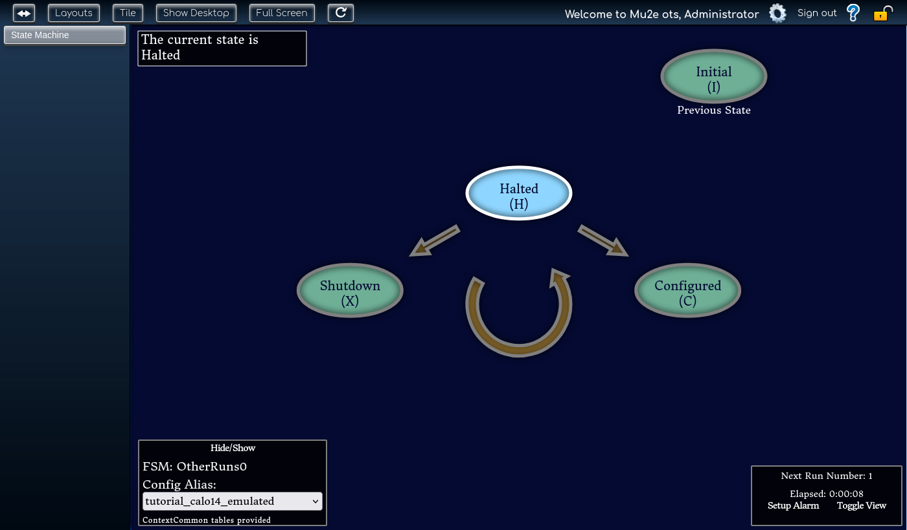
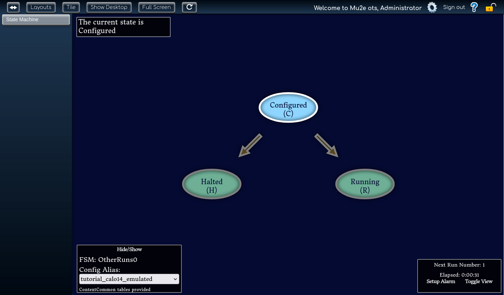
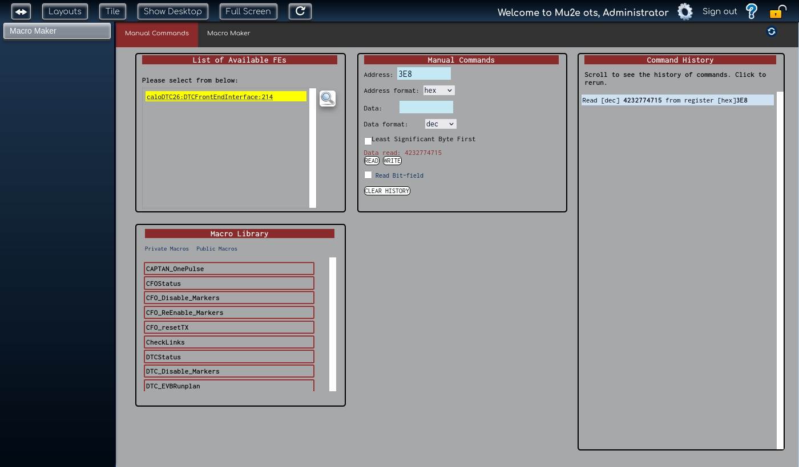
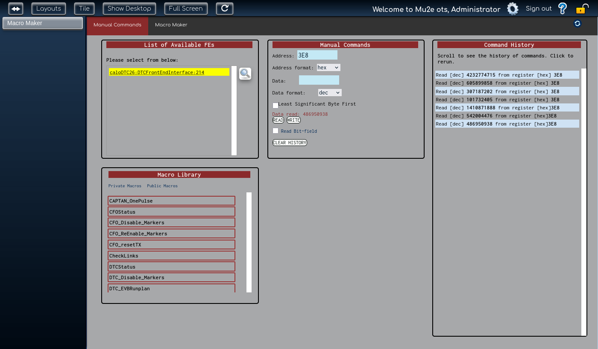

# Adding a ROC DCS Register to EPICS

<!-- slide 1 -->
## Adding a ROC DCS Register to EPICS

Put a register of a readout controller (ROC) under Mu2e Slow Controls and EPICS (Experimental Physics and Industrial Control System) monitoring, then watch the value wiggle in the Dashboard every five seconds. The register is read with the Detector Control System (DCS) protocol, which the data transfer controller (DTC) uses to talk to the ROC.



Last checked: November 2026, using a software-emulated DTC and ROC on calo-14. No real hardware was harmed.

<!-- slide 2 -->
## What You Will Learn

- How a ROC register value travels from the front-end to the **Slow Controls Dashboard**, through the DTC, the artdaq EPICS metric plugin, and the OTSReader IOC.
- How to add a **slow-controls channel** in the Configuration, link it to a ROC address, and set the sampling interval to five seconds.
- How to **Configure** with an alias that turns on only the emulated front-end.
- How to confirm the new channel appears in the EPICS PV file and the Dashboard.
- How to **set the register** from Macro Maker and see the Dashboard widget follow.

<!-- slide 3 -->
## Before You Start

- The **Slow Controls Dashboard** is part of *otsdaq*, and you can set up *otsdaq* Slow Controls in more than one way. Mu2e uses the `EpicsInterface` plugin, which reads the channels from the Mu2e EPICS system; the file-based `OtsSlowControlsInterface` plugin is another choice. The *otsdaq* tutorials at [otsdaq.fnal.gov/tutorials](https://otsdaq.fnal.gov/tutorials/index.html) cover the Dashboard and both plugins. Recommended: [Introducing Slow Controls](https://otsdaq.fnal.gov/tutorials/introducing-slow-controls.html), [Slow Controls Dashboard Features and Hotkeys](https://otsdaq.fnal.gov/tutorials/slow-controls-dashboard-features-and-hotkeys.html), and [Setting Up EPICS With *otsdaq*](https://otsdaq.fnal.gov/tutorials/setting-up-epics-with-otsdaq.html), which covers the `EpicsInterface` plugin. Read those first if Slow Controls are new to you.
- Access to the **HWDev** Desktop on mu2e-cfo-01 (port 3155). HWDev uses NoSecurity mode, so no login is needed.
- The **calo-14** front-end context must be running (check **App Status** on the Desktop).
- A software-emulated DTC (`caloDTC26`) and ROC (`caloROC156`) already configured on calo-14, with `EmulatorMode=True` on the DTC and `EmulateInDTCHardware=True` on the ROC.

<!-- slide 4 -->
## How a ROC Register Reaches the Dashboard

1. The **front-end** (DTC interface) polls the ROC register at the interval you set (five seconds in this tutorial), using a DCS read from the DTC to the ROC.
2. The front-end calls `sendMetric` with the value. The artdaq **EPICS metric plugin** sends it to the IOC with `ca_put`.
3. The **OTSReader IOC** serves the value as an EPICS process variable (PV). The IOC reloads when the PV file changes (a cron job checks every two minutes).
4. The **Slow Controls Dashboard** reads the PV through the `EpicsInterface` plugin and shows it in a widget. Which plugin the Dashboard uses is the `SlowControlsInterfacePluginType` setting in its `SlowControlsDashboardSupervisorTable` row, and Mu2e sets it to `EpicsInterface`. The *otsdaq* tutorials listed in Before You Start explain the setting.

The PV name follows the pattern `<owner>:<subsystem>:<ROC UID>:<channel name>`.

<!-- slide 5 -->
## The Emulated DTC and ROC on calo-14

Good news: you do not need real hardware. This tutorial uses a software emulator:

- **caloDTC26** has `EmulatorMode=True` in the DTC Interface Table. The DTC library starts `mu2esim` instead of talking to a PCIe card.
- **caloROC156** has `EmulateInDTCHardware=True` in the ROC Interface Table. The emulator answers DCS reads and writes for every 16-bit address.
- Address **1000** (0x3E8) holds a fake temperature: it starts at 2500 (25.00 degrees C) and walks randomly by plus or minus 0.05 degrees C on each read, staying between 15.00 and 35.00.
- Writing to address 1000 from Macro Maker sets the value. The random walk continues from whatever you write.

The alias `tutorial_calo14_emulated` turns on only this DTC and ROC, with all real DTCs off.

<!-- slide 6 -->
## Check That the Front-End Context Is Running

First, is the front-end alive? Open **App Status** from the Desktop and look for `Calo14FEContext` in the list:



The context must show a status of **up** (or the equivalent indicator). If it is not running, ask the shift crew or the DAQ expert to restart the calo contexts. Do not poke it yourself.

<!-- slide 7 -->
## Check the Slow-Controls Channel

In the Configuration GUI, find the slow-controls channel group for `caloROC156`. Good news: the tutorial alias already has a channel named **tutorialTemperature**, so you only need to check it. Its settings:

| Setting | Value |
| --- | --- |
| Channel Name | `tutorialTemperature` |
| Address | `1000` (0x3E8) |
| Type | `16b` (16-bit unsigned) |
| Delay Between Samples | `5` seconds |
| Units | `degC` |
| Transformation | `x/100` |
| Monitoring Enabled | `Yes` |

The transformation `x/100` converts the raw value (hundredths of a degree) to degrees Celsius.

<!-- slide 8 -->
## Enable Slow Controls on the DTC

For the DTC to poll the slow-controls channels of the ROC, **SlowControlsEnable** must be **On** in the DTC Interface Table row for `caloDTC26`.

When this is On and the system is in the Configured or Halted state, the front-end reads the channels at their configured intervals and sends the values as metrics.

The polling pauses while the system is Running (data-taking has priority over slow controls on the DTC link). Data first, temperatures later.

<!-- slide 9 -->
## Select the Tutorial Alias

Open the **State Machine** from the Desktop. In the alias dropdown, select **tutorial_calo14_emulated**:


This alias switches on only the emulated DTC and ROC on calo-14, and leaves all real hardware off.

<!-- slide 10 -->
## Initialize

Click **Initialize**. The system transitions from Initial to **Halted**:



If the transition fails and the system goes to **Failed**, click **Halt** to return to Halted, then try again. A common cause is a stale process left over from a previous session.

<!-- slide 11 -->
## Configure

Click **Configure**. The system transitions to **Configured**:



Now the front-end gets busy. During Configure, it:
- Starts `mu2esim` (the software emulator).
- Writes the EPICS PV file with the new `tutorialTemperature` channel.
- Sets the dirty flag so the DCS cron restarts the IOC within two minutes.
- Begins polling the ROC register every five seconds.

<!-- slide 12 -->
## The New PV Appears

Be patient: after the IOC restarts (up to two minutes), the new PV is live. The PV file at `$OTSDAQ_EPICS_DATA/hwdev_otsdaq_dtc-ai.dbg` contains a record like:

```
record(ai, "hwdev:calo:caloROC156:tutorialTemperature") {
    field(DESC, "tutorialTemperature")
    field(EGU,  "degC")
    field(PREC, "2")
}
```

The PV name follows the pattern `<owner>:calo:<ROC UID>:<channel name>`. This record tells the IOC to serve the value as an analog input, in degrees Celsius, with two decimal places.

<!-- slide 13 -->
## Watch It in a Widget

Open the **Slow Controls Dashboard** from the Desktop. Place a **Time Chart** widget and add the channel `hwdev:calo:caloROC156:tutorialTemperature` from the channel list.

Click **Go Live!**. Now you will see the temperature wandering by about 0.05 degrees C every five seconds, the random walk of the emulated register.

The value in the Configured state is typically near 25 degrees C, the starting point of the emulator.

<!-- slide 14 -->
## Read the Register in Macro Maker

Open **Macro Maker** from the Desktop. Select the front-end `caloDTC26` from the list, type address **0x3E8** (1000), and click **Read**:



The returned value is the raw register (hundredths of a degree). Divide by 100 to get the temperature in degrees C.

<!-- slide 15 -->
## See the Values Change

Click **Read** several more times. Each read gives you a slightly different value. That is the random walk at work:



The front-end is also reading this register every five seconds for slow controls. Each slow-controls read advances the random walk, so the value changes even between your Macro Maker reads. Sneaky.

<!-- slide 16 -->
## Set the Temperature From Macro Maker

In Macro Maker, type address **0x3E8**, enter a value (for example **3000** for 30.00 degrees C), and click **Write**.

The emulator stores the new value. The next slow-controls sample, within five seconds, picks it up and sends it to EPICS. The Dashboard widget jumps to the new temperature, then resumes wandering from there.

Handy for testing alarms or thresholds: write a value that crosses the limit, and confirm that the alarm fires.

<!-- slide 17 -->
## Where to Go for More

- **Create a channel from scratch:** this tutorial used a channel already in the tutorial alias. [Setting Up EPICS With *otsdaq*](https://otsdaq.fnal.gov/tutorials/setting-up-epics-with-otsdaq.html) shows how to create one in the Configuration GUI.
- **Alarms and thresholds:** EPICS alarm limits are set in the PV record and shown in the Dashboard alarm views. See [Slow Controls Dashboard Features and Hotkeys](https://otsdaq.fnal.gov/tutorials/slow-controls-dashboard-features-and-hotkeys.html).
- **Real hardware:** the emulated DTC and ROC take the same slow-controls path as real ones, but the values are simulated.
- **Running state:** slow-controls polling pauses during a run. The last value before the run stays in the Dashboard until the run ends and polling resumes.

<!-- slide 18 -->
## Things to Remember

- The PV file is rewritten on every Configure. The IOC restarts within two minutes (DCS cron).
- One ROC register becomes one EPICS PV: `<owner>:<subsystem>:<ROC UID>:<channel>`.
- The transformation `x/100` happens in the front-end before `sendMetric`. The PV carries the transformed value.
- Polling runs in Configured and Halted, not in Running.
- The emulator's random walk is per-read: both Macro Maker reads and slow-controls reads advance it.

<!-- slide 19 -->
## That's It!

You added a ROC register to slow-controls monitoring, watched the value wander in the Dashboard, and set it from Macro Maker. Not bad for a fake thermometer.

**Next**: [Saving and Recalling a Mu2e Snapshot](saving-and-recalling-a-mu2e-snapshot.md) shows you how to save and recall USER_DATA and the configuration database.
