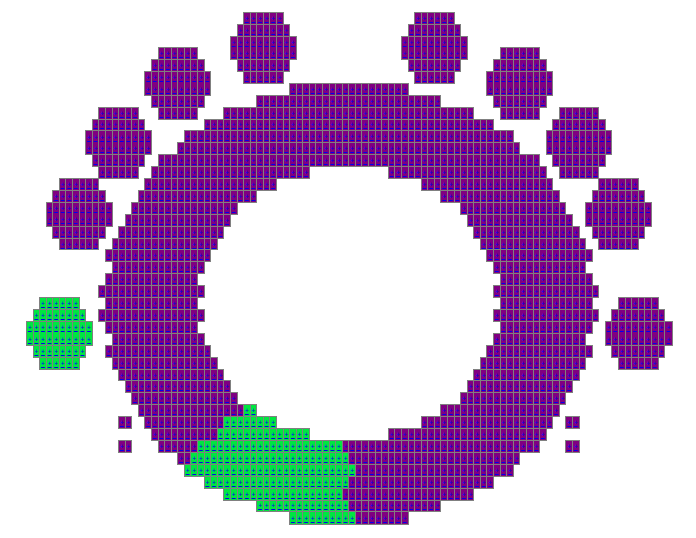

# DCS Dashboard for Mu2e

<!-- placeholder written 2026-11-19 at the owner's request: no content yet. Fill from a look at the Mu2e Calorimeter dashboard on the Slow Controls Dashboard: which pages the full set has, which widgets each page uses, and how the crystal bitmap arrangement is built (the owner supplied the example picture of the crystal map with highlighted regions; ask what the green regions mean and which widget draws it). Ask the owner which other subsystems have a full dashboard. Nothing here was run. -->

<!-- slide 1 -->
## DCS Dashboard for Mu2e

How the Muon-to-Electron Conversion Experiment (Mu2e) shows its detector slow controls on the *otsdaq* Slow Controls Dashboard, with the full Calorimeter dashboard as the example

Last checked: November 2026, *otsdaq* v3.12.00

<!-- slide 2 -->
## Coming Soon

Hold on, this one is not written yet. It is a placeholder. When it is done, it will show you the Mu2e Detector Control System (DCS) dashboard, and in particular the full Calorimeter dashboard:

- The set of dashboard pages of the Calorimeter, and the widgets on each page.
- The bitmap arrangement: a map of the detector made of many small cells, as in the picture, with highlighted regions.

- In the meantime, the generic dashboard tutorials: [Introducing Slow Controls](https://otsdaq.fnal.gov/tutorials/introducing-slow-controls.html), [Slow Controls Dashboard Features and Hotkeys](https://otsdaq.fnal.gov/tutorials/slow-controls-dashboard-features-and-hotkeys.html) and [Slow Controls: Adding, Modifying, and Creating Widgets](https://otsdaq.fnal.gov/tutorials/slow-controls-adding-modifying-and-creating-widgets.html).
- And to see how a ROC register gets to the dashboard: [Adding a ROC DCS Register to EPICS](adding-a-roc-register-to-slow-controls.md).
