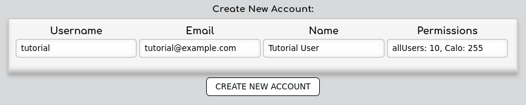
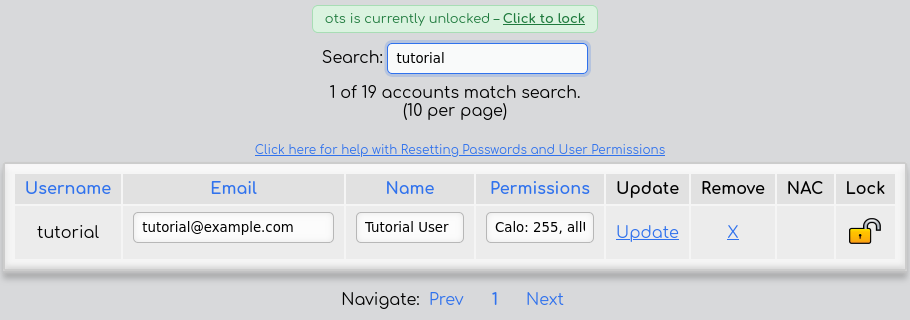
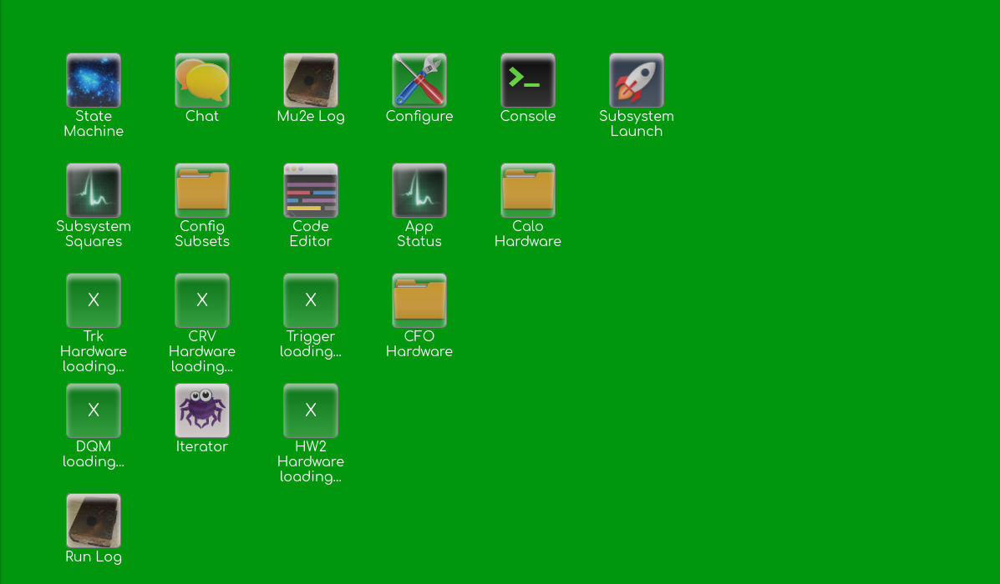
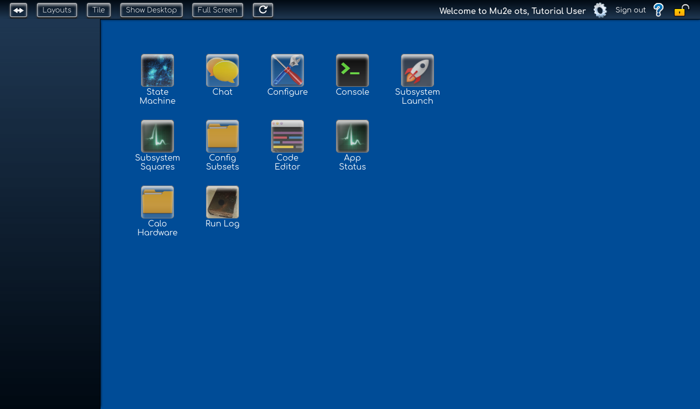
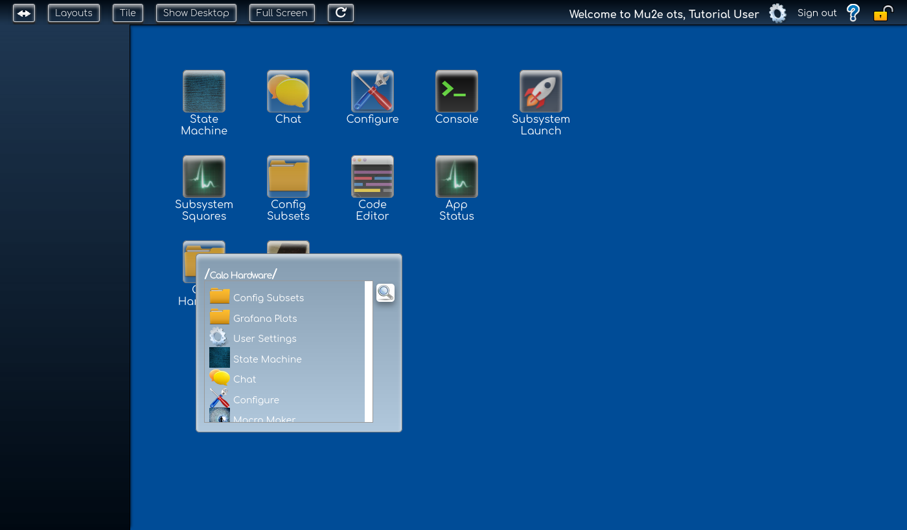

# Mu2e Subsystems in otsdaq

<!-- written 2026-11-17 from setup_ots.sh (per-subsystem block, port, partition, owner, repository and database settings) and from the ServiceData/ActiveTableGroups.cfg of each Data_<subsystem> folder in the ops install. Group names and keys are as of that date. Not yet in the page, waiting for a look at a live Mu2e instance in the GUI (the owner has to give the web login): how user permission levels are set at Mu2e (accounts, security mode of each instance, the RequiredPermissionLevel of the icons), the Desktop icon convention of Mu2e (folders, captions, images, ots: icons), and how the shift instance ties the other instances together. The expansion of the prefix MC2 in the group names and of the setup names HWDev and tem is not known to the author: ask the owner. Nothing in the page was run. See MU2E_TUTORIALS_NOT_TESTED.md. -->

<!-- slide 1 -->
## Mu2e Subsystems in otsdaq

How the Muon-to-Electron Conversion Experiment (Mu2e) divides its *otsdaq* system into subsystems, and how the subsystems are named


Last checked: November 2026, *otsdaq* v3.12.00

<!-- slide 2 -->
## What You Will Learn

- How Mu2e starts one *otsdaq* subsystem with `setup_ots.sh`.
- Why you log in at the `shift` Gateway only, and not at each subsystem.
- How the HTTPS port translation map lets users on the Fermilab network reach every subsystem without a tunnel.
- Which subsystems Mu2e has, and which repository each one uses.
- How the `shift` Gateway knows each subsystem: an icon and a path row for each one.
- The Mu2e naming conventions: ports, user data folders, databases, owner names, group names and front-end names.
- How user permissions work at Mu2e: one permission group for each subsystem.
- How to make a demonstration user, and what a normal user and an administrator see.
- The Mu2e Desktop icon convention.

<!-- slide 3 -->
## Before You Start

- Recommended prerequisite: [Multiple Subsystems in *otsdaq*](https://otsdaq.fnal.gov/tutorials/multiple-subsystems-in-otsdaq.html), the experiment-independent tutorial. It explains what a subsystem is, and what each one has of its own. This page does not repeat it.
- `yourhost` stands for the name of a machine, and `username` for your account name on it.
- The names come from `setup_ots.sh` of the Mu2e ops install and from the folders next to it.
- Recommended: [User Management](https://otsdaq.fnal.gov/tutorials/user-management.html) for accounts and permission levels, and [Changing/Adding Icons](https://otsdaq.fnal.gov/tutorials/changing-adding-icons.html) for the Desktop icons. This page shows how Mu2e uses them.
- The live walk-through was done on the development area `ots_ops_tdaq`: its `shift` Gateway is at port 3175 on mu2e-cfo-01.

<!-- slide 4 -->
## Subsystems at Mu2e

At Mu2e, each part of the system runs as its own *otsdaq* instance: one for the calorimeter, one for the tracker, and so on. Each has its own Gateway, user data folder and active groups, and they share one configuration database.

You choose the instance by its name, when you set up the terminal:

```bash
source setup_ots.sh calo
```

With no name, `setup_ots.sh` uses the last one that you used. It keeps that name in the file `.ots_setup_type.txt` next to it.

<!-- slide 5 -->
## How the Shift Gateway Knows a Subsystem

The top level needs two pieces for each subsystem, as in [Multiple Subsystems in *otsdaq*](https://otsdaq.fnal.gov/tutorials/multiple-subsystems-in-otsdaq.html). At Mu2e they are in the **Context** group of `shift` (`MC2ShiftContext`):

- A **Desktop icon** with the name `<Name>_HardwareGateway`, for example `Calo_HardwareGateway`. Its caption is `Calo Icons`, its **FolderPath** is `Calo Hardware`, and its **AlternateText** is `CAL`.
- A row of the **SubsystemUserDataPathsTable** whose **SubsystemUID** is that same `CAL`.

Three icons do not follow the name pattern: `Trigger_Gateway`, `DQM_Gateway` and `DCS_Dashboard`.

<!-- slide 6 -->
## The Subsystem Icon Address

The **WindowContentURL** of the icon starts with `ots:` and builds the host and the port from environment variables, as text:

```
ots:${CALO_IP}:$(($CALO_OTS_MAIN_PORT + $TOP_OTS_PORT_OFFSET))
```

- `CALO_IP` and `CALO_OTS_MAIN_PORT` are set by `setup_ots.sh`: see the base ports on the next slides.
- No port number is typed into the table: the numbers come from `setup_ots.sh`.
- The other subsystem icons have the same form, with `TRK`, `CRV`, `TRIGGER`, `DQM`, `CFO` or `DCS` in place of `CALO`.
- `STM_HardwareGateway` and `STM_ReadoutGateway` use `STM_IP`, `STM_OTS_MAIN_PORT` and `STMREAD_OTS_MAIN_PORT`. The HW2 icon uses `CFO_IP` and `HWDEV_OTS_MAIN_PORT`.

<!-- slide 7 -->
## The Subsystem User Data Paths

Each **SubsystemUID** has a **SubsystemUserDataPath**: the user name that owns the folder, the machine, and the `Data_` folder of the subsystem:

| SubsystemUID | User data folder |
|--------------|------------------|
| `CAL` | `Data_calo` |
| `TRK` | `Data_tracker` |
| `CRV` | `Data_crv` |
| `TRG` | `Data_trigger` |
| `DCS`, `CFO`, `DQM` | `Data_dcs`, `Data_cfo`, `Data_dqm` |
| `STM_GRs_MC2`, `STM_readout_GRs_MC2` | `Data_stm`, `Data_stm_readout` |
| `Top_GRs_MC2` | `Data_shift` |

Most paths use the owner `mu2eshift`, the machine `OTS_GATEWAY_HOST` and the folder `OTS_SETUP_DIR` from the environment. The STM paths name the machine mu2e-trk-05 and the owner `mu2estm`.

<!-- slide 8 -->
## What the Development Gateway Shows

On the `shift` Desktop of the development area, the subsystem folders do not all come up.

- **Calo Hardware** and **CFO Hardware** are folders.
- **Trk Hardware**, **CRV Hardware**, **Trigger**, **DQM** and **HW2 Hardware** show an `X` and the word *loading...*: the top level has not received the icons of that subsystem.
- The icons for STM and DCS have **Status** `Off` in the table, so they are not on the Desktop at all.

<!-- slide 9 -->
## The Detector Subsystems

| Name | Repository | Owner | Base port |
|------|------------|-------|-----------|
| `calo` | `otsdaq-mu2e-calorimeter` | `Mu2e-Calo` | 3025 |
| `tracker` | `otsdaq-mu2e-tracker` | `Mu2e-Tracker` | 3065 |
| `crv` | `otsdaq-mu2e-crv` | `Mu2e-CRV` | 3085 |
| `trigger` | `otsdaq-mu2e-trigger` | `Mu2e-Trigger` | 3045 |
| `stm` | `otsdaq-mu2e-stm` | `Mu2e-STM` | 30351 |
| `stm_readout` | `otsdaq-mu2e-stm` | `Mu2e-STM` | 30371 |
| `tem` | `otsdaq-mu2e-extmon` | `Mu2e-ExtMon` | 4045 |

CRV is the Cosmic Ray Veto, and STM the Stopping Target Monitor. The base port is the number in `setup_ots.sh`, before the offset (see below).

<!-- slide 10 -->
## The Operations and Monitoring Subsystems

| Name | Repository | Owner | Base port |
|------|------------|-------|-----------|
| `shift` | `otsdaq-mu2e` | `Mu2e` | 3075 |
| `shift1` | `otsdaq-mu2e` | `Mu2e-Hardware` | 3095 |
| `cfo` | `otsdaq-mu2e` | `Mu2e-Hardware` | 3095 |
| `dcs` | `otsdaq-mu2e` | `Mu2e-DCS` | 5019 |
| `dqm` | `otsdaq-mu2e-dqm` | `Mu2e` | 5029 |
| `dqmcalo` | `otsdaq-mu2e-trigger` | `Mu2e` | 3095 |
| `dqmtrk` | `otsdaq-mu2e-tracker` | `Mu2e` | 3070 |
| `dqmstm` | `otsdaq-mu2e-stm` | `Mu2e` | 5039 |

DCS is the Detector Control System, and DQM is Data Quality Monitoring. More names are in `setup_ots.sh`: `HWDev`, `HWDev2`, `shift2`, `sync`, `mergetrk`, `aggregator`, `stmdbtest` and `02`.

<!-- slide 11 -->
## Naming: Ports

The Gateway port of a subsystem is its base port plus an **offset**. The offset comes from the name of the install folder, or from the environment variable `MU2E_SETUP_PORT_OFFSET`. The folder names that set one are `ots_display` (300), `ots_ops_dev` (500), the calorimeter folders (700), the tracker folders (900) and the CRV folders (200).

- You can also give it on the command line: `source setup_ots.sh portoffset 100 calo`.
- The base ports are the ports of the live Mu2e system (offset 0). The development area `ots_ops_tdaq` uses an offset of 100: on mu2e-cfo-01 its `shift` Gateway is at port 3175, its calorimeter Gateway at 3125 and its HWDev Gateway at 3155.
- Macro Maker has its own User Datagram Protocol (UDP) port, the main port plus a fixed Macro Maker offset.
- Three names share the base port 3095: `shift1`, `cfo` and `dqmcalo`. They cannot run at the same time on one machine with the same offset.

<!-- slide 12 -->
## Log In at the Shift Gateway

At Mu2e, `shift` is the **top-level Gateway**. Log in there, and open the other subsystems from its Desktop.

- You can log in to a subsystem on its own, but then that subsystem keeps its own usernames, passwords and new account codes (NAC). That is not the recommended way, for Mu2e or for any *otsdaq* system.
- The `shift` Desktop handles the redirects to the subsystems.
- The accounts and permission levels live in the `Data_shift` folder, in one place. The generic explanation is in [Multiple Subsystems in *otsdaq*](https://otsdaq.fnal.gov/tutorials/multiple-subsystems-in-otsdaq.html) and [User Management](https://otsdaq.fnal.gov/tutorials/user-management.html).

<!-- slide 13 -->
## No Tunnels at Mu2e: HTTPS Ports

Users on the Fermilab network do not make ssh tunnels. Mu2e gives every subsystem an HTTPS port on one gateway machine, and the **port translation map** tells the `shift` Gateway which one to hand to your browser. The entry point is the `shift` Gateway at `https://mu2egateway02.fnal.gov:8443`.

The map is the file `webPortTranslation.dat` in the `otsdaq-mu2e-config` folder. `install_ots_ops.sh` links it to `ServiceData/webPortTranslation.dat` of each user data folder, and `setup_ots.sh` points `OTS_PORT_TRANSLATION_MAP_FILE` at it.

<!-- slide 14 -->
## The Mu2e Port Translation Map

Every line has the request origin `https://mu2egateway02.fnal.gov:8443`, the subsystem's real port on its machine, and the HTTPS port to use instead:

| Subsystem | Real port | HTTPS port |
|-----------|-----------|------------|
| `shift` | 3075 | 8443 |
| `cfo` and `shift1` | 3095 | 8444 |
| `dcs` | 5019 | 8445 |
| `dqm` | 5029 | 8449 |
| `trigger` | 3045 | 8450 |
| `calo` | 3025 | 8453 |
| `crv` | 3085 | 8454 |
| `tracker` | 3065 | 8455 |
| `stm` | 30351 | 8456 |
| `tem` | 4045 | 8457 |

Each port has two lines, one for the machine's full name and one for `localhost`. The DCS machine also has ports 5020, 5021 and 3000, mapped to 8446, 8447 and 8448. The real ports are the base ports of the previous slides, so this file is the map of the live system (offset 0). A development area with an offset needs a map with its own ports.

<!-- slide 15 -->
## What the Map Does

The Gateway looks up the address of a subsystem exactly, as scheme, host and port, for the request origin `https://mu2egateway02.fnal.gov:8443`. If it finds a line, the browser gets the HTTPS port instead. The rest of the address stays. Remote icons of a subsystem get the same treatment.

- Both `mu2e-cfo-01.fnal.gov` and `localhost` are listed for each port, because an address is matched as written.
- The header of the Mu2e file points out that `localhost:30351` (`stm`) and `localhost:3035` overlap, so the longer one is listed first.
- A new subsystem needs a new pair of lines in the file, and a restart of the Gateway.

<!-- slide 16 -->
## Naming: User Data and Databases

Each subsystem has a user data folder named `Data_` and its setup name, next to `setup_ots.sh`: `Data_calo`, `Data_tracker`, `Data_crv`, `Data_trigger`, `Data_shift`, `Data_cfo`, `Data_dcs`, `Data_dqm` and so on.

- `setup_ots.sh` sets `USER_DATA` to that folder.
- Most subsystems use the one shared Mu2e database, `mu2eots_db`, on the Mu2e DCS machines. `setup_ots.sh` switches to it with `use_mongodb=1`.
- `stmdbtest`, `shift2`, `dqmcalo`, `dqmtrk`, `mergetrk`, `aggregator`, `tem` and `02` use a file-based database instead: the folder `databases_` and the setup name.
- The *artdaq* partition number is also fixed per name, for example 4 for `calo`, 8 for `tracker` and 9 for `crv`.

<!-- slide 17 -->
## Naming: Owner and EPICS

`OTS_OWNER` names who the instance belongs to: `Mu2e` by default, and `Mu2e-Calo`, `Mu2e-Tracker`, `Mu2e-CRV`, `Mu2e-STM`, `Mu2e-Trigger`, `Mu2e-DCS`, `Mu2e-ExtMon` or `Mu2e-Hardware` where the subsystem sets it.

A second variable, `MU2E_OWNER`, is the setup name in lower case. The Experimental Physics and Industrial Control System (EPICS) channel file of an instance has it in front of its name, for example `hwdev_otsdaq_dtc-ai.dbg`, and the channel names (Process Variables) start with it too: see [Adding a ROC DCS Register to EPICS](adding-a-roc-register-to-slow-controls.md).

<!-- slide 18 -->
## Naming: Group Names

Most subsystems name their three active groups with a `MC2` prefix, the subsystem, and the group type. These are the active groups of the ops install on 2026-11-17:

| Subsystem | Context | Backbone | Configuration |
|-----------|---------|----------|---------------|
| `calo` | `MC2CaloContext` | `MC2CaloBackbone` | `MC2CaloConfig` |
| `tracker` | `MC2TrkContext` | `MC2TrkBackbone` | `MC2TrkConfig` |
| `cfo` | `MC2CFOContext` | `MC2CFOBackbone` | `MC2CFOConfig` |
| `shift` | `MC2ShiftContext` | `MC2ShiftBackbone` | `MC2ShiftConfig` |
| `dqm` | `MC2DQMContext` | `MC2DQMBackbone` | `MC2DQMConfig` |

Three differ: CRV uses `MC2CrvStandaloneContext`, DCS uses `OpsShiftDCSContext`, and the trigger uses `DAQRoomHorizontalSliceTestContext`.

<!-- slide 19 -->
## Naming: Front-Ends

Front-end names say the subsystem, the kind of board and a number:

- A data transfer controller (DTC) front-end is `caloDTC26`, and a readout controller (ROC) is `caloROC156`: the subsystem, `DTC` or `ROC`, and the number.
- A **Context** that holds the front-ends of one machine is named after it, for example `calo_14_FEContext` for the machine calo-14.
- The Slow Controls channel names are built from the owner, the subsystem and the ROC name.

<!-- slide 20 -->
## User Permissions at Mu2e

A permission **group** can have any name, and a user can have a level, any number from 0 to 255, in each group. The group `allUsers` is always there. Mu2e adds one group for each subsystem: `CFO`, `CRV`, `Calo`, `DCS`, `DEV`, `DQM`, `STM`, `Trig` and `Trk`. The accounts of the whole system are kept at the `shift` Gateway: you make them in its **Settings** window, as in [User Management](https://otsdaq.fnal.gov/tutorials/user-management.html).

- A bigger number can do more. 0 is inactive and 255 is an administrator; 1, 10 and 100 are the usual steps in between, and other numbers, such as 5, are allowed.
- The account list shows each level as text, for example `Calo: 255, allUsers: 10`.
- A user with `allUsers: 255` and every group at 255 is an administrator of the whole system.
- A user can be an expert in one subsystem only: give that group a high level, and the other groups a low level or none.

<!-- slide 21 -->
## Which Group Opens Which Icon

The **RequiredPermissionLevel** of an icon is a number, which is compared with the level of `allUsers`, or a group and a level, which is compared with the level of that group:

| Icon | RequiredPermissionLevel |
|------|-------------------------|
| State Machine, Chat, Console, Subsystem Launch, Code Editor, App Status | `1` |
| Configure | `10` |
| Iterator | `255` |
| Mu2e Log | `DEV:1` |
| Calo Icons, Trk Icons, CRV Icons, STM Icons | `Calo:1`, `Trk:1`, `CRV:1`, `STM:1` |
| Trigger Icons, DCS Icons, DQM Icons, CFO Icons | `Trig:1`, `DCS:1`, `DQM:1`, `CFO:1` |
| HW2 Icons | `CFO:1` |

<!-- slide 22 -->
## Make a Demonstration User

On the `shift` Gateway of the development area, an administrator opens the **Settings** window (the gear in the top right corner), scrolls to **Accounts**, and fills **Create New Account**:



- **Username** `tutorial`, an example email address, the name `Tutorial User`.
- **Permissions** `allUsers: 10, Calo: 255`: a normal user, and an administrator of `Calo` only.
- Click **Create New Account**. A green box says *New account added successfully!*

<!-- slide 23 -->
## The New Account and Its Code

The new row is in the **Accounts** table, with the permissions as text and a **NAC**, the new account code:



Give the NAC to the user. It is used once, for the first login: on the login page click **New User?**, type the username, a password twice and the NAC. The Desktop then says *Welcome to Mu2e ots* and the name of the account. A first-time user also gets the *Desktop Introduction* tooltip: close it with **Esc**.

<!-- slide 24 -->
## A Normal User and an Administrator

The administrator, with every group at 255, sees all the icons:



It shows **Mu2e Log** and **Iterator**, and a folder for each subsystem. The icons with an `X` are subsystems whose icons have not been received. Compare the Desktop of the `tutorial` user on the next slide.

<!-- slide 25 -->
## What the Normal User Sees

`tutorial` has `allUsers: 10, Calo: 255`:



- **Configure** is there: it needs level 10, and `allUsers` is 10.
- **Calo Hardware** is there: it needs level 1 in `Calo`.
- **Mu2e Log** is not there (it needs `DEV:1`), nor **Iterator** (it needs 255), nor **CFO Hardware** (it needs `CFO:1`).

<!-- slide 26 -->
## Open a Subsystem Without a Second Login

The `tutorial` user logged in at `shift` only. Click **Calo Hardware**: a list named `/Calo Hardware/` opens, with the icons of the calorimeter instance:



The list has the calorimeter's **State Machine**, **Configure**, **Macro Maker**, **Slow Controls Dashboard**, **Console**, **Iterator**, **Code Editor**, **App Status**, **Calo Config**, **ROC Firmware Manager**, **Wiz-Mode Config** and more. The user has no account at the calorimeter instance.

<!-- slide 27 -->
## How the Level Reaches the Subsystem

The `shift` Gateway checks your login for the subsystem. It also passes on your level. The comment in the Gateway code gives this example: a user with `HW: 255, allUsers: 1`, and an icon that needs `HW: 1`, becomes `HW: 255, allUsers: 255` at the subsystem. The user is an expert there.

- So a Mu2e user is an expert in a subsystem when the level in that subsystem's group is high.
- A user whose level in the group is missing gets level 0 there, and no access.
- Change a level in **Settings** at `shift`, with **Update**. You do not make accounts at the subsystem.

<!-- slide 28 -->
## Desktop Icon Convention: Generic Icons

The icons that every *otsdaq* has keep their *otsdaq* names. At Mu2e they are in the **DesktopIconTable** of `MC2ShiftContext`:

| UID | Caption | Level | Folder |
|-----|---------|-------|--------|
| `FSM` | State Machine | `1` | none |
| `ConfigureGUI` | Configure | `10` | none |
| `Logbook` | Mu2e Log | `DEV:1` | none |
| `Iterator` | Iterator | `255` | none |
| `SubsystemLaunch`, `SubsystemSquares` | Subsystem Launch, Subsystem Squares | `1` | none |
| `SystemDiagram` | System Diagram | `1` | Config Subsets |

Several icons stay in the table with **Status** `Off`, such as `Visualizer`, `MacroMaker` and `ControlsDashboard`. See [Changing/Adding Icons](https://otsdaq.fnal.gov/tutorials/changing-adding-icons.html).

<!-- slide 29 -->
## Desktop Icon Convention: Subsystem Icons

One icon for each subsystem, with a fixed pattern:

| Part | Pattern | Example |
|------|---------|---------|
| UID | `<Name>_HardwareGateway` | `Calo_HardwareGateway` |
| Caption | `<Name> Icons` | `Calo Icons` |
| FolderPath | `<Name> Hardware` | `Calo Hardware` |
| AlternateText | short code in capitals | `CAL` |
| RequiredPermissionLevel | `<Group>:1` | `Calo:1` |
| ImageURL | `DEFAULT` | the folder picture |

A new subsystem needs this icon, a row in the **SubsystemUserDataPathsTable** with the same code, a group name in the accounts, and a pair of lines in the port translation map of the live system.

<!-- slide 30 -->
## Things to Remember

- A subsystem is chosen by its name: `source setup_ots.sh <name>`.
- Its user data folder is `Data_<name>`, and its Gateway port is a base port plus an offset.
- Subsystems have an owner name (`Mu2e-Calo`) and a lower-case name that starts the EPICS file and channel names.
- Group names look like `MC2CaloContext`: prefix, subsystem and group type.
- Front-ends are `<subsystem>DTC<n>` and `<subsystem>ROC<n>`.
- Log in at `shift` only. A user has a level for `allUsers` and a level for each subsystem group.
- A subsystem icon is `<Name>_HardwareGateway`, in the folder `<Name> Hardware`, and needs `<Group>:1`.

<!-- slide 31 -->
## That's It! What Next?

You can now read the name of any Mu2e subsystem and tell where its data, port and groups are.

- Add a register to Slow Controls: [Adding a ROC DCS Register to EPICS](adding-a-roc-register-to-slow-controls.md).
- Save and recall a whole setup: [Saving and Recalling a Mu2e Snapshot](saving-and-recalling-a-mu2e-snapshot.md).
- The experiment-independent version of this page: [Multiple Subsystems in *otsdaq*](https://otsdaq.fnal.gov/tutorials/multiple-subsystems-in-otsdaq.html).
