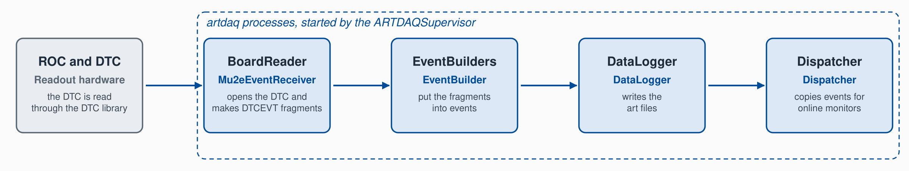
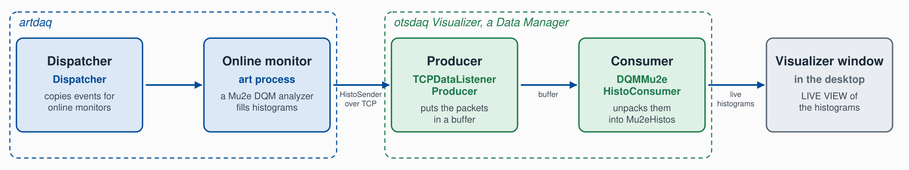

# Running artdaq in Mu2e

<!-- written 2026-11-19 from the source of the Mu2e repositories, read at origin/develop (origin/main for Offline) with git show, not from the working trees (the local otsdaq-mu2e-dqm checkout was 53 commits behind). Nothing was run and no Mu2e instance was opened. The real ARTDAQ table rows of the subsystems (process labels, hosts, ports) are not in these repositories, so the naming slides state only what the code and the docs show. Notes for the author are in doc/MU2E_TUTORIALS_NOT_TESTED.md. Draft. -->

<!-- slide 1 -->
## Running artdaq in Mu2e

What is different when the Muon-to-Electron Conversion Experiment (Mu2e) runs *artdaq*? You will see how Mu2e names its pieces, how a histogram travels from an *art* module to the *otsdaq* Visualizer, and which C++ classes do the work, with links to GitHub


Last checked: November 2026, *otsdaq* v3.12.00

<!-- slide 2 -->
## What You Will Learn

- The Mu2e data path: from the readout hardware, through a Mu2e BoardReader, to the *artdaq* Dispatcher.
- What differs from the generic *artdaq* tutorial.
- The Mu2e naming: process labels, fragment types, *art* product names, and DTC, ROC and subsystem names.
- The Mu2e C++ classes: generators, fragment overlays, decoders, *art* modules and front-ends, each with a GitHub link.
- The Mu2e data quality monitoring (DQM) flow: online monitor, analyzers, `HistoSender`, the consumer, and the `Mu2eHistos` folder.
- What to check when the live view in the Visualizer is empty.

<!-- slide 3 -->
## Before You Start

- Recommended prerequisite: [Running *artdaq* with *otsdaq*](https://otsdaq.fnal.gov/tutorials/running-artdaq-with-otsdaq.html), the experiment-independent tutorial. It explains *artdaq*, the ARTDAQ tables and the generic DQM flow. This page shows what Mu2e does differently and does not repeat it, so start there if *artdaq* is new to you.
- Also useful: [Mu2e Subsystems in *otsdaq*](mu2e-subsystems-in-otsdaq.md), for the subsystem, partition and front-end names.
- Links go to the `develop` branch of each repository on GitHub (`main` for Offline). Line numbers move when the code changes, so do not be shocked if a link lands a few lines off.
- Some repositories also have a `mu2e/ots_ops` branch. Run `git branch` in your repository to see which branch your install uses.

<!-- slide 4 -->
## The Mu2e Data Path



Mu2e reads real hardware, not an emulator. Here is the path. A BoardReader opens a Data Transfer Controller (DTC) through the DTC library, and its generator, a Mu2e class, makes *artdaq* fragments of type `DTCEVT`. The EventBuilders, the DataLogger and the Dispatcher are the generic *artdaq* classes, set up by the ARTDAQ tables.

<!-- slide 5 -->
## The Mu2e DQM Flow



So how does a histogram get on your screen? An online monitor is an *art* process that reads events from the Dispatcher. A Mu2e analyzer in it fills histograms and sends them with `HistoSender` over the Transmission Control Protocol (TCP) to the Visualizer. The address and port are parameters of the analyzer, and the same port is the `ServerPort` of the `TCPDataListenerProducer`.

<!-- slide 6 -->
## What Differs From the Generic Tutorial

| | Generic tutorial | Mu2e |
|---|---|---|
| Data source | hardware emulator, UDP port 4000 | DTC and ROC hardware, through the DTC library |
| BoardReader generator | `UDPReceiver` | `Mu2eEventReceiver` and its relatives |
| Fragment type | `UDP` | `DTCEVT`, and `CFO` |
| Online monitor analyzer | `UDPEmulatorDQM` | `CaloDQM`, `TrackerDQM`, `TriggerDQM` and others |
| DQM consumer | `DemoDQMHistoReceiverConsumer` | `DQMMu2eHistoConsumer` |
| Top folder of the DQM file | none | `Mu2eHistos` |
| Consumer settings | `SaveDQMFile`, `DQMFilePath`, `DQMFileNamePrefix` | `SaveFile`, `FilePath`, `RadixFileName` |
| Sender and receiver | `otsdaq-demo` | `otsdaq-mu2e`, same packet format |

<!-- slide 7 -->
## Naming: Process Labels

What is a process label? Each *artdaq* process is a row of one ARTDAQ table, and the UID of the row is its label:

| Process | Table |
|---|---|
| BoardReader | **ARTDAQBoardReaderTable** |
| EventBuilder | **ARTDAQEventBuilderTable** |
| DataLogger | **ARTDAQDataLoggerTable** |
| Dispatcher | **ARTDAQDispatcherTable** |
| RoutingManager | **ARTDAQRoutingManagerTable** |
| Online monitor | **ARTDAQOnlineMonitorTable** |
| Supervisor | **ARTDAQSupervisorTable** |

- *otsdaq* writes one FHiCL file for each label in `Data/ARTDAQConfigurations/`.
- The code does not fix the labels. Each subsystem picks the UIDs of its own rows.
- Older Mu2e pages show labels such as `builder0` and `logger0`, from a tracker test stand: [otsdaq_mu2e.org](https://github.com/Mu2e/otsdaq-mu2e/blob/develop/doc/otsdaq_mu2e.org).

<!-- slide 8 -->
## Naming: Fragment Types

The fragment types of Mu2e are in [`FragmentType.hh`](https://github.com/Mu2e/artdaq-core-mu2e/blob/develop/artdaq-core-mu2e/Overlays/FragmentType.hh#L11). Each is a user fragment type of *artdaq*:

| Name | Meaning |
|---|---|
| `DTCEVT` | DTC event fragment |
| `CFO` | CFO fragment |
| `TRK`, `CAL`, `CRV`, `STM` | tracker, calorimeter, cosmic ray veto and stopping target monitor fragments |
| `TRKDTC` | hardware debug information |
| `DBG` | debug packet |
| `MISSED` | placeholder for a missed fragment |

- In Mu2e running only `DTCEVT` and `CFO` carry data. The others are empty: see the comment in [`FragmentAggregator`](https://github.com/Mu2e/artdaq-mu2e/blob/develop/artdaq-mu2e/ArtModules/FragmentAggregator_module.cc#L19).
- The *art* jobs use the naming helper plugin `Mu2e`, class [`Mu2eFragmentNameHelper`](https://github.com/Mu2e/artdaq-core-mu2e/blob/develop/artdaq-core-mu2e/Overlays/Mu2e_fragmentNameHelper.cc#L12), in their `ArtdaqFragmentNamingServiceInterface` service.

<!-- slide 9 -->
## Naming: Fragment Products in art

In an *art* job, the fragments of one EventBuilder come as a product named by type, module label, instance name and process name:

```
artdaq::Fragments_daq_DTCEVT_eb01
```

- `daq` is the module label, `DTCEVT` the instance name (the fragment type), and `eb01` the process name of the *art* job of one EventBuilder.
- In production files there are 17 EventBuilders, so the same data has 17 process names.
- [`FragmentAggregator`](https://github.com/Mu2e/artdaq-mu2e/blob/develop/artdaq-mu2e/ArtModules/FragmentAggregator_module.cc#L19) collects the products of all EventBuilders under one label, for the instance names `CFO` and `DTCEVT`.

<!-- slide 10 -->
## Naming: DTCs, ROCs, Subsystems and Partitions

- Subsystem names and partitions are in [Mu2e Subsystems in *otsdaq*](mu2e-subsystems-in-otsdaq.md).
- Front-ends are named `<subsystem>DTC<n>` and `<subsystem>ROC<n>`, for example `caloDTC26` and `caloROC156`.
- You tell a Mu2e BoardReader which DTC to open with the generator parameters `dtc_id`, `roc_mask`, `dtc_position_in_chain` and `n_dtcs_in_chain`. The parameter `sim_mode` selects a simulated DTC.
- **Careful, the names fool everyone:** `EventBuilderDTCID`, `EventBuilderMode` and the other `EventBuilder...` fields of the DTC front-end belong to the event building inside the DTC hardware. They are not the *artdaq* EventBuilder.
- The port of the *artdaq* DAQInterface is `ARTDAQ_BASE_PORT` plus the partition times `ARTDAQ_PORTS_PER_PARTITION`.

<!-- slide 11 -->
## Naming: Metrics in EPICS

The *artdaq* processes can send their metrics to EPICS. Mu2e uses these settings, from [otsdaq_mu2e.org](https://github.com/Mu2e/otsdaq-mu2e/blob/develop/doc/otsdaq_mu2e.org):

- The channel name preamble of the supervisor is `TDAQ_mu2e`, or `TDAQ_` and the user name.
- The `epics` metric plugin, at level 3.
- The metric parameter `channel_name_prefix` is `Mu2e`.

Together they give the channel prefix `Mu2e:TDAQ_mu2e`.

<!-- slide 12 -->
## Mu2e C++ Classes: BoardReader Generators

A BoardReader runs a generator. All of these derive from `artdaq::CommandableFragmentGenerator`:

| Class | Role |
|---|---|
| [`Mu2eEventReceiverBase`](https://github.com/Mu2e/artdaq-mu2e/blob/develop/artdaq-mu2e/Generators/Mu2eEventReceiverBase.hh#L33) | opens the DTC, builds `DTCEVT` fragments; the base of the next three |
| [`Mu2eEventReceiver`](https://github.com/Mu2e/artdaq-mu2e/blob/develop/artdaq-mu2e/Generators/Mu2eEventReceiver_generator.cc#L12) | basic DTC readout |
| [`CRVReceiver`](https://github.com/Mu2e/artdaq-mu2e/blob/develop/artdaq-mu2e/Generators/CRVReceiver_generator.cc#L9) | cosmic ray veto readout |
| [`Mu2eCaloEventReceiver`](https://github.com/Mu2e/otsdaq-mu2e-calorimeter/blob/develop/otsdaq-mu2e-calorimeter/Generators/Mu2eCaloEventReceiver_generator.cc#L22) | calorimeter readout |
| [`Mu2eSubEventReceiver`](https://github.com/Mu2e/artdaq-mu2e/blob/develop/artdaq-mu2e/Generators/Mu2eSubEventReceiver_generator.cc#L61) | reads DTCs that are not in hardware event building mode |
| [`CFODataReceiver`](https://github.com/Mu2e/artdaq-mu2e/blob/develop/artdaq-mu2e/Generators/CFODataReceiver_generator.cc#L33) | reads the CFO records and makes `CFO` fragments |
| [`CFOZmqReceiver`](https://github.com/Mu2e/artdaq-mu2e/blob/develop/artdaq-mu2e/Generators/CFOZmqReceiver_generator.cc#L15) | `CFO` fragments over ZeroMQ |

<!-- slide 13 -->
## Mu2e C++ Classes: Fragments and Decoders

The overlays wrap a fragment, and the decoders read the packets inside. All are in the repository `artdaq-core-mu2e`:

| Class | Role |
|---|---|
| [`DTCEventFragment`](https://github.com/Mu2e/artdaq-core-mu2e/blob/develop/artdaq-core-mu2e/Overlays/DTCEventFragment.hh#L17) | overlay of a `DTCEVT` fragment |
| [`CFOEventFragment`](https://github.com/Mu2e/artdaq-core-mu2e/blob/develop/artdaq-core-mu2e/Overlays/CFOEventFragment.hh#L16) | overlay of a `CFO` fragment |
| [`STMFragment`](https://github.com/Mu2e/artdaq-core-mu2e/blob/develop/artdaq-core-mu2e/Overlays/STMFragment.hh#L10) | overlay of an `STM` fragment |
| [`DTCDataDecoder`](https://github.com/Mu2e/artdaq-core-mu2e/blob/develop/artdaq-core-mu2e/Overlays/Decoders/DTCDataDecoder.hh#L17) | base of the decoders |
| [`TrackerDataDecoder`](https://github.com/Mu2e/artdaq-core-mu2e/blob/develop/artdaq-core-mu2e/Overlays/Decoders/TrackerDataDecoder.hh#L13), [`CalorimeterDataDecoder`](https://github.com/Mu2e/artdaq-core-mu2e/blob/develop/artdaq-core-mu2e/Overlays/Decoders/CalorimeterDataDecoder.hh#L11), [`CRVDataDecoder`](https://github.com/Mu2e/artdaq-core-mu2e/blob/develop/artdaq-core-mu2e/Overlays/Decoders/CRVDataDecoder.hh#L12) | decoders for tracker, calorimeter and cosmic ray veto data |

Decoders are used inside the DQM analyzers: the tracker analyzer reads each `DTCEVT` fragment through its overlay and decoder.

<!-- slide 14 -->
## Mu2e C++ Classes: Art Modules Around the Data

- [`FragmentAggregator`](https://github.com/Mu2e/artdaq-mu2e/blob/develop/artdaq-mu2e/ArtModules/FragmentAggregator_module.cc#L19) (a producer) collects the fragments of all EventBuilders.
- [`DTCEventDump`](https://github.com/Mu2e/artdaq-mu2e/blob/develop/artdaq-mu2e/ArtModules/DTCEventDump_module.cc#L27) (an analyzer) prints the `DTCEVT` fragments of an event.
- The Offline repository turns fragments into detector data: [CaloDigisFromDTCEvents](https://github.com/Mu2e/Offline/blob/main/DAQ/src/CaloDigisFromDTCEvents_module.cc), [CaloHitsFromDTCEvents](https://github.com/Mu2e/Offline/blob/main/DAQ/src/CaloHitsFromDTCEvents_module.cc), [StrawDigisFromArtdaqFragments](https://github.com/Mu2e/Offline/blob/main/DAQ/src/StrawDigisFromArtdaqFragments_module.cc), [CrvDigisFromArtdaqFragmentsFEBII](https://github.com/Mu2e/Offline/blob/main/DAQ/src/CrvDigisFromArtdaqFragmentsFEBII_module.cc) and [MSDHitsFromDTCEvents](https://github.com/Mu2e/Offline/blob/main/DAQ/src/MSDHitsFromDTCEvents_module.cc).
- The DQM analyzers of the next slides run these producers in the same *art* job, or read the fragments themselves.

<!-- slide 15 -->
## Mu2e C++ Classes: Front-Ends That Start the Hardware

Who configures the hardware? Not the BoardReaders. The front-ends do:

| Class | Role |
|---|---|
| [`CFOandDTCCoreVInterface`](https://github.com/Mu2e/otsdaq-mu2e/blob/develop/otsdaq-mu2e/CFOandDTCCore/CFOandDTCCoreVInterface.h#L19) | base of the DTC and CFO front-ends; it knows whether *artdaq* is enabled |
| [`DTCFrontEndInterface`](https://github.com/Mu2e/otsdaq-mu2e/blob/develop/otsdaq-mu2e/FEInterfaces/DTCFrontEndInterface.h#L19) | configures and starts a DTC |
| [`CFOFrontEndInterface`](https://github.com/Mu2e/otsdaq-mu2e/blob/develop/otsdaq-mu2e/FEInterfaces/CFOFrontEndInterface.h#L15) | configures and starts the CFO |
| [`ROCCoreVInterface`](https://github.com/Mu2e/otsdaq-mu2e/blob/develop/otsdaq-mu2e/ROCCore/ROCCoreVInterface.h#L11) | base of the ROC front-ends |
| [`DBRunInfo`](https://github.com/Mu2e/otsdaq-mu2e/blob/develop/otsdaq-mu2e/RunInfoPlugins/DBRunInfo.h#L45) | gets the run number from a database |

- A BoardReader can run with `skip_dtc_init` true, so that it does not touch the DTC when it configures.
- The order of configure and start is in [event_building_mode_configure.md](https://github.com/Mu2e/otsdaq-mu2e/blob/develop/doc/event_building_mode_configure.md).

<!-- slide 16 -->
## Mu2e DQM: The Online Monitor

- An online monitor is a row of **ARTDAQOnlineMonitorTable**. Its supervisor, the **ARTDAQOnlineMonitorSupervisor**, is a generic *otsdaq* class.
- It writes an *art* FHiCL file from the row, and starts `art` with it. The *art* job reads events from the Dispatcher over TCP.
- The settings of the row include the monitor ID, the TCP listen port, and links to the *art* settings, the filter paths and the Dispatcher.
- The analyzers of the Mu2e DQM are *art* modules in the repository [otsdaq-mu2e-dqm](https://github.com/Mu2e/otsdaq-mu2e-dqm). They are listed on the next slide.

<!-- slide 17 -->
## Mu2e DQM: The Analyzers

Every analyzer is an `art::EDAnalyzer`, with the parameters `address`, `port` and `moduleTag`. The folder is what it sends to `HistoSender`:

| Analyzer | Folder sent |
|---|---|
| [`CaloDQM`](https://github.com/Mu2e/otsdaq-mu2e-dqm/blob/develop/otsdaq-mu2e-dqm/ArtModules/CaloDQM_module.cc#L29) | `<moduleTag>_summary` |
| [`TriggerDQM`](https://github.com/Mu2e/otsdaq-mu2e-dqm/blob/develop/otsdaq-mu2e-dqm/ArtModules/TriggerDQM_module.cc#L28) | `<moduleTag>_summary` |
| [`IntensityInfoDQM`](https://github.com/Mu2e/otsdaq-mu2e-dqm/blob/develop/otsdaq-mu2e-dqm/ArtModules/IntensityInfoDQM_module.cc#L30) | `<moduleTag>_summary` |
| [`TrackerDQM`](https://github.com/Mu2e/otsdaq-mu2e-dqm/blob/develop/otsdaq-mu2e-dqm/ArtModules/TrackerDQM_module.cc#L36) | `<moduleTag>_summary`, and more for the histogram types asked for |
| [`SimpleDQM`](https://github.com/Mu2e/otsdaq-mu2e-dqm/blob/develop/otsdaq-mu2e-dqm/ArtModules/SimpleDQM_module.cc#L26) | `<outputTag>_summary:replace` |
| [`CaloDigiDQM`](https://github.com/Mu2e/otsdaq-mu2e-dqm/blob/develop/otsdaq-mu2e-dqm/ArtModules/CaloDigiDQM_module.cc#L177) | `<moduleTag>/...:replace`: global, per disk and board, waveforms, laser |
| [`CaloIERCDQM`](https://github.com/Mu2e/otsdaq-mu2e-dqm/blob/develop/otsdaq-mu2e-dqm/ArtModules/CaloIERCDQM_module.cc#L38) | `<moduleTag>/singleChan`, `/sameBoard`, `/diffBoard`, all `:replace` |
| [`IntegrationDQM`](https://github.com/Mu2e/otsdaq-mu2e-dqm/blob/develop/otsdaq-mu2e-dqm/ArtModules/IntegrationDQM_module.cc#L37) | `integration_summary/calo`, `/trk`, `/crv`, `/stm`, `/global`, all `:replace` |

[`LumiDQM`](https://github.com/Mu2e/otsdaq-mu2e-dqm/blob/develop/otsdaq-mu2e-dqm/ArtModules/LumiDQM_module.cc#L42) has no `HistoSender`: it writes with the *art* `TFileService`.

<!-- slide 18 -->
## Mu2e DQM: HistoSender, :add and :replace

- [`HistoSender`](https://github.com/Mu2e/otsdaq-mu2e/blob/develop/otsdaq-mu2e/ArtModules/HistoSender.hh#L11) connects to the listener when it is created, and `sendHistograms` sends one packet for each call: the folder name, a magic number, the number of objects, and the objects as ROOT streams. [This overload](https://github.com/Mu2e/otsdaq-mu2e/blob/develop/otsdaq-mu2e/ArtModules/HistoSender.cc#L53) takes a map of folder names to histograms, and [`sendGraphs`](https://github.com/Mu2e/otsdaq-mu2e/blob/develop/otsdaq-mu2e/ArtModules/HistoSender.cc#L73) does the same for graphs.
- The sender does not know `:add` and `:replace`. The folder name may end in one of them, and [the receiver](https://github.com/Mu2e/otsdaq-mu2e/blob/develop/otsdaq-mu2e/ArtModules/HistoReceiver.cc#L89) reads it: `:add` adds the new histogram to the one it has, `:replace` empties the old one first. With no suffix it adds.
- An analyzer that sends with `:add`, or no suffix, must reset its own histograms after each send, or it sends them twice. The analyzers `TrackerDQM`, `CaloDQM`, `TriggerDQM` and `IntensityInfoDQM` clone and reset. The ones that send `:replace` need no reset.
- The class that unpacks the packets is [`HistoReceiver`](https://github.com/Mu2e/otsdaq-mu2e/blob/develop/otsdaq-mu2e/ArtModules/HistoReceiver.hh#L12).

<!-- slide 19 -->
## Mu2e DQM: The Consumer and the Mu2eHistos Folder

[`DQMMu2eHistoConsumer`](https://github.com/Mu2e/otsdaq-mu2e/blob/develop/otsdaq-mu2e/DataProcessorPlugins/DQMMu2eHistoConsumer.h#L22) is a DQM consumer of the Visualizer's Data Manager.

- At **Start** it opens the file `<FilePath>/<RadixFileName>_Run<n>.root`, and [makes the folder `Mu2eHistos`](https://github.com/Mu2e/otsdaq-mu2e/blob/develop/otsdaq-mu2e/DataProcessorPlugins/DQMMu2eHistoConsumer_processor.cc#L60) in it. Everything the analyzers send goes under that folder.
- It reads its settings from three columns: `SaveFile`, `FilePath` and `RadixFileName`. The generic consumers read `SaveDQMFile`, `DQMFilePath` and `DQMFileNamePrefix`.
- It reports its state to the Gateway: the run number, the age of the last packet, and for each top-level folder the packets received and the time since the last one.
- The plugin is [registered as a processor](https://github.com/Mu2e/otsdaq-mu2e/blob/develop/otsdaq-mu2e/DataProcessorPlugins/DQMMu2eHistoConsumer_processor.cc#L187) by name.
- Open **LIVE VIEW** in the **Visualizer** while the run is **Running**, and the folders and histograms of `Mu2eHistos` are listed.

<!-- slide 20 -->
## Mu2e DQM: The Tables

Good news: the Visualizer is a Data Manager, and its tables are the generic ones:

| Table | What to set |
|---|---|
| **ARTDAQOnlineMonitorTable** | the online monitor row, with its *art* job and the analyzer |
| **DataBufferTable** | the buffer of the Visualizer, linked to its processors |
| **DataProcessorTable** | a producer row, `TCPDataListenerProducer`, and a consumer row, `DQMMu2eHistoConsumer` |
| **TCPDataListenerProducerTable** | `ServerPort`, which must be the `port` of the analyzers |
| the settings table of the consumer | `SaveFile`, `FilePath`, `RadixFileName` |

- The consumer must sit in a buffer of the Visualizer's Data Manager. Only that Data Manager serves the live view.
- The `address` of the analyzer is the host that runs the Visualizer.

<!-- slide 21 -->
## When the Mu2e Live View Is Empty

| Check | How |
|---|---|
| Is the run **Running**? | `LIVE_DQM.root` exists only between **Start** and **Stop** |
| Does the analyzer send? | its `port` and `address` must be those of the listener; the `HistoSender` connects when the analyzer is created, at **Start** |
| Do packets arrive? | the status of the consumer shows the age of the last packet and the packets of each folder |
| Is the consumer in the Visualizer's Data Manager? | **DataBufferTable** and **DataProcessorTable** of the Visualizer supervisor |
| Is the data in the saved file? | **Stop** the run and open `<FilePath>/<RadixFileName>_Run<n>.root`: histograms there, but not live, point at the live view, not at the data path |

For the generic version of this check, with the Visualizer requests, see [Running *artdaq* with *otsdaq*](https://otsdaq.fnal.gov/tutorials/running-artdaq-with-otsdaq.html).

<!-- slide 22 -->
## Things to Remember

- The Mu2e specific part of the data path is the BoardReader: the generators, the fragment types and their overlays and decoders. After that the processes are generic *artdaq*.
- The Mu2e specific part of the DQM flow is the analyzers and the consumer `DQMMu2eHistoConsumer`, which makes `Mu2eHistos`. The packet format and `HistoSender` are the same as in the generic tutorial.
- A process label is the UID of a row in an ARTDAQ table. Each subsystem chooses its own.
- `:add` and `:replace` are decided by the sender, in the folder name.
- Want the details? Read the class on GitHub: every class on these slides has a link.

<!-- slide 23 -->
## That's It! What Next?

You have seen how Mu2e names its *artdaq* pieces, how its histograms reach the Visualizer, and which classes do the work. That is a lot of classes. Well done.

- Mu2e subsystems, ports and front-end names: [Mu2e Subsystems in *otsdaq*](mu2e-subsystems-in-otsdaq.md).
- Next, put a value in the slow controls of a ROC: [Adding a ROC DCS Register to EPICS](adding-a-roc-register-to-slow-controls.md).
- The generic version of this tutorial: [Running *artdaq* with *otsdaq*](https://otsdaq.fnal.gov/tutorials/running-artdaq-with-otsdaq.html).
- The event building order for the DTC and CFO: [event_building_mode_configure.md](https://github.com/Mu2e/otsdaq-mu2e/blob/develop/doc/event_building_mode_configure.md).

<!-- slide 24 -->
## Appendix: The Repositories

| Repository | What is in it for this tutorial |
|---|---|
| [otsdaq-mu2e](https://github.com/Mu2e/otsdaq-mu2e) | the DQM consumer, `HistoSender`, `HistoReceiver`, the DTC, CFO and ROC front-ends, `DBRunInfo` |
| [otsdaq-mu2e-dqm](https://github.com/Mu2e/otsdaq-mu2e-dqm) | the DQM analyzers |
| [artdaq-mu2e](https://github.com/Mu2e/artdaq-mu2e) | the BoardReader generators and the *art* modules |
| [artdaq-core-mu2e](https://github.com/Mu2e/artdaq-core-mu2e) | the fragment types, overlays and decoders |
| [mu2e-pcie-utils](https://github.com/Mu2e/mu2e-pcie-utils) | the DTC and CFO libraries, `DTCLib::DTC` |
| [otsdaq-mu2e-calorimeter](https://github.com/Mu2e/otsdaq-mu2e-calorimeter) | the calorimeter generator |
| [Offline](https://github.com/Mu2e/Offline) | the modules that decode the fragments |

The generic classes, `ARTDAQSupervisor` and `ARTDAQOnlineMonitorSupervisor`, are in [*otsdaq*](https://github.com/art-daq/otsdaq).
