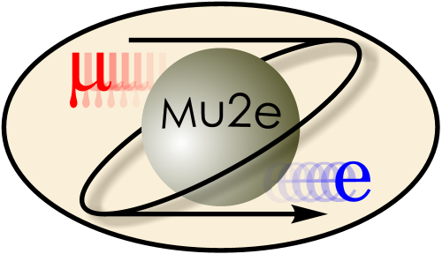

# Saving and Recalling a Mu2e Snapshot

<!-- slide 1 -->
## Saving and Recalling a Mu2e Snapshot

Ever wished you could freeze your *otsdaq* setup, break everything, and then thaw it? Save your setup as a named snapshot on the Mu2e server, and bring a snapshot saved by someone else back into your own area.



Written from the Mu2e snapshot scripts in November 2026.

<!-- slide 2 -->
## What You Will Learn

- What a snapshot holds, and what it leaves out.
- How to save your user data and databases as a snapshot with a unique name.
- How to list the snapshots on the server.
- How to recall a snapshot, and what happens to the setup you had before.
- How the ops versions save and recall several areas at once.

<!-- slide 3 -->
## Before You Start

- Recommended: [Installing and Starting *otsdaq*](https://otsdaq.fnal.gov/tutorials/installing-and-starting-otsdaq.html), so you know your *otsdaq* area, `setup_ots.sh` and the `ots` command.
- Your Fermilab username must be on the Kerberos access list (the `.k5login` file) of the `mu2eshift` account, because snapshots are copied to and from the Mu2e gateway machine `mu2egateway01` with `ssh` and `scp` (secure copy).
- A terminal in your *otsdaq* area, the directory that holds `setup_ots.sh`, with `setup_ots.sh` already sourced. The scripts read `USER_DATA` and `ARTDAQ_DATABASE_URI` from that setup.
- The scripts are in `otsdaq-mu2e/tools`. Run them by name when they are on your path after the setup, or with `./` in front.

<!-- slide 4 -->
## What a Snapshot Holds

Now you are probably wondering, "What exactly is in a snapshot?" Two zip files, stored on the Mu2e NFS (Network File System) server in `/mu2e/DataFiles/UserSnapshots/`:

- `snapshot_<name>_Data.zip` holds your user data folder (`USER_DATA`, also called `NoGitData`): the Configuration tables info, Macros, desktop icons, `setup_ots.sh`, `mongodb_setup.sh` and `db_setup_ots.sh` when they exist.
- `snapshot_<name>_database.zip` holds your databases folder (from `ARTDAQ_DATABASE_URI`): all table versions and group keys.

What does it leave out, on purpose? Logs, output data, run numbers, macro history, console snapshots, tooltip data, and the list of active groups. A recall keeps your own run number.

<!-- slide 5 -->
## Pick a Unique Name

- Use a short name that says why you saved it, such as `postGlobalRun2` or `bug_crashOnReset`.
- Do not reuse a name. The create script asks before it overwrites a snapshot with the same name, and an overwrite cannot be undone.
- Names are shared by everyone on the server, so check the list first (next slides).
- This tutorial uses the name `tutorial_demo`. Replace it with your own name in every command.

<!-- slide 6 -->
## Look at What Is Already Saved

Before you pick a name, peek at what everyone else has already saved:

```
reset_mu2e_ots_snapshot.sh --list
```

It runs `ls -lrta` on `/mu2e/DataFiles/UserSnapshots/` through `ssh` and prints one line per zip file, oldest first. Each snapshot name appears twice, once as `_Data.zip` and once as `_database.zip`.

<!-- slide 7 -->
## Save a Snapshot

From your *otsdaq* area:

```
create_mu2e_ots_snapshot.sh --name tutorial_demo
```

The script copies your user data and databases, removes the items listed on slide 4, writes the two zip files, and copies them to the server. If the name already exists it asks `y` or `n` before overwriting.

To name the folders yourself, keep this order: `--name`, then `--data`, then `--database`:

```
create_mu2e_ots_snapshot.sh --name tutorial_demo --data /path/to/NoGitData --database /path/to/databases
```

<!-- slide 8 -->
## Save Only the Data

Pass `skip` as the database to save the user data without the databases:

```
create_mu2e_ots_snapshot.sh --name tutorial_demo_data_only --data /path/to/NoGitData --database skip
```

No database zip is made or copied. This is how the ops script saves the extra data areas that share one database.

<!-- slide 9 -->
## Recall a Snapshot

Recall replaces your current setup, so read the next slide first. Seriously. From your *otsdaq* area:

```
reset_mu2e_ots_snapshot.sh --name tutorial_demo
```

The script runs `ots --killall` and `killall -9 ots_udp_hw_emulator`, downloads the two helper scripts from the `develop` branch of the `otsdaq_mu2e` repository on GitHub, and runs them. They copy the two zip files from the server, unpack them, and put the contents where `USER_DATA` and `ARTDAQ_DATABASE_URI` point.

<!-- slide 10 -->
## What Happens to Your Old Setup

- Your current user data folder is renamed to `<USER_DATA>.bak`, and your current databases folder to `<databases>.bak`.
- Only one backup is kept. A second recall deletes the first `.bak` folders. Copy them somewhere else if you want to keep them.
- Logs, `ARTDAQConfigurations`, `TriggerConfigurations` and `OutputData` are removed from the recalled user data, and your run number files are copied back from the backup.
- `killall -9 ots_udp_hw_emulator` stops every emulator started with that name on the machine, including other people's. Do not recall on a shared machine while others are running, or you will make enemies.

<!-- slide 11 -->
## Start ots and Check the Result

Time to see your handiwork. Start *otsdaq* as usual:

```
ots
```

Open the Configure app and the table and group views, and look for the Context, Configuration and Backbone group keys and aliases that were in the snapshot.

<!-- slide 12 -->
## The ops Version

The Mu2e ops machines have the same two steps, but for the whole ops layout:

```
create_mu2e_ops_snapshot.sh --name tutorial_demo
```

```
reset_mu2e_ops_snapshot.sh --name tutorial_demo
```

- They save and recall `Data_HWDev` with the `databases_HWDev` folder under the name you give.
- They also save `Data_shift`, `Data_shift1` and `Data_trigger`, without databases, under `tutorial_demo_shift`, `tutorial_demo_shift1` and `tutorial_demo_trigger`.
- Use them only on the ops machines, from the directory that holds those folders.

<!-- slide 13 -->
## Things to Remember

- A snapshot is a copy at one moment. Later changes in your area are not in it.
- Names are shared and are not versioned. Pick a unique one.
- Recall keeps one backup only, and stops every ots emulator on the machine.
- The recall scripts come from GitHub `develop`, not from your local `otsdaq-mu2e`.
- Try it first in a scratch *otsdaq* area, because a recall replaces your current setup.

<!-- slide 14 -->
## That's It! What Next?

You can now save a named snapshot of your user data and databases, and recall one that someone else saved. Not bad for a pair of scripts.

- Go back to the [Mu2e tutorials home page](index.md).
- Next: [Adding a ROC DCS Register to EPICS](adding-a-roc-register-to-slow-controls.md).
